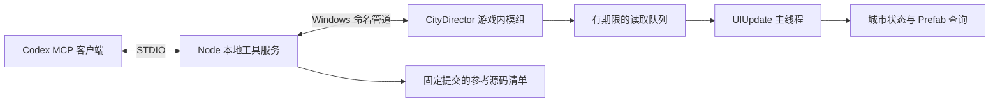

# 架构与下一阶段

## 产品目标

由 Codex 持续编辑同一份城市创作工程，支持资产摆放与定制、演员/道具/车辆动线、镜头，
以及真正参与城市模拟的公交和地铁。CineMap 是交互体验参考，不将其未核实的内部实现作为依赖。

## 当前实现

Windows 命名管道适合本机首版，不占 TCP 端口，访问权限限定到启动游戏的 Windows 用户。
这与上游 HTTP 桥接属于不同传输实现；后续可以增加 HTTP 适配，不改变游戏命令模型。

目前网络线程只做解析、排队和静态 ping；所有 ECS 读取都在 UIUpdate。
每连接一次请求、4 个并行连接、请求 8 KiB 上限、队列 64 个上限、每帧最多处理 8 个。
读取请求 4 秒失效，连接 5 秒截止，客户端 6 秒截止；超时不自动重试。
这些额度是开发初值，实际游戏测试后再调整。

目前暴露的是 `bridge.ping`、`game.state`、`assets.search`。
`director_reference_sources` 在本地读取来源清单，不需要游戏运行。
城市读取会给出加载会话标识；它不是持久对象 ID。

## 后续模块边界

| 模块 | 负责 | 最关键的边界 |
|---|---|---|
| 观察 | 截图、选择对象、地图、道路连通和对象检查 | 游戏未加载或证据不充分时返回明确状态 |
| 场景编辑 | 摆放、移动、旋转、组合、颜色和变体 | 单实例编辑与全局模板编辑分开 |
| 导演编排 | 演员、道具、车辆、镜头时间轴 | 导演时间可回放；城市模拟不能任意倒带 |
| 原生交通 | 公交、地铁、站序、途经点、车型和诊断 | 接入原生寻路、车辆段、站台及乘客逻辑 |
| 资产构建 | Blender 输出、验证、导入和版本切换 | 明确哪些类型支持热替换、哪些需要重载 |
| 工程与任务 | 持久对象 ID、批量操作、日志、长任务 | 保存读取后重建对象映射；不把 Entity.Index 当永久 ID |

场景车辆按时间线精确表演，与遵守红绿灯、拥堵的原生车辆是不同模式。
人物首版计划使用独立演员；不能把“演员到达车站”当作“模拟居民已能乘车”。

## 写操作协议尚未实现

下一阶段引入 `operationId`、会话/对象版本、预览结果和幂等记录。
操作状态应区分排队、执行、完成、失败、取消和“结果未知”。断线后先查询原操作，不重新发送建造。
主线程取出已过期请求时必须跳过；开始执行后取消不能被伪装为回滚成功。
变更范围和逆操作记录属于场景层；城市经济和交通演化只通过存档检查点恢复。

## 接下来按顺序验收

1. **游戏内观察闭环**：加载测试城市；Codex 读取城市名称和暂停状态，搜索一个已知资产；
   切换存档后会话标识更新；退出游戏后工具返回断开，而不是旧结果。
2. **放置一棵树并继续编辑**：预览、原生放置、得到实例引用、截图复核、移动、撤销；
   存档重开后能重新识别。再扩展建筑和组合。
3. **真实公交最小闭环**：两站、可用道路和车库；创建线路后观察车辆生成、到站、停靠；
   有客流需求时验证上下客。失败要能区分基础设施、可达性和需求。
4. **导演最小闭环**：一个独立演员、一辆场景车、一段镜头，可暂停和重复播放；
   然后研究接管原生车辆及可靠归还。
5. **资产变体闭环**：单建筑外观参数或几何变体、保存、重载、替换与回退；
   随后做地铁站等带功能约束的资产。

这些是开发计划，不是当前工具已实现的能力。
